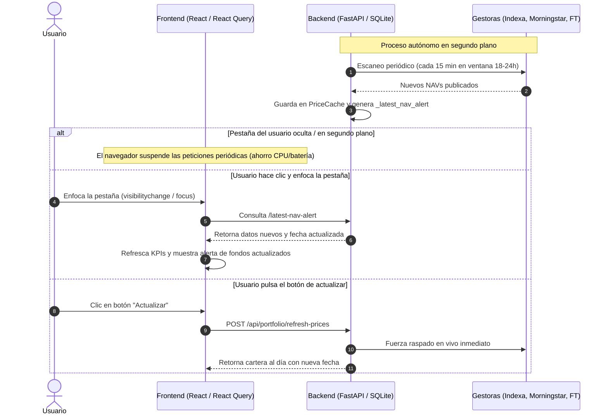

# Historial de Chat - Sesión Antigravity
- **Fecha de exportación:** 2026-10-20 11:47:53
- **ID de Conversación:** `991484f1-8900-44cc-a185-e89a30a22c4d`
- **Total de interacciones registradas:** 5

> [!NOTE]
> Este archivo fue exportado automáticamente para preservar el contexto entre diferentes PCs.
> En un nuevo ordenador o chat, puedes referenciar este archivo con `@.chats/latest_chat.md`

---

### 👤 Usuario (2026-10-20 09:01:21)

el rendimiento anualizado no tiene sentido. revisa los datos

---

### 🤖 Asistente (2026-10-20 09:13:13)

He revisado los datos y el motor financiero de cálculo de rentabilidad. Tenías toda la razón: el **rendimiento anualizado** mostraba un valor desorbitado e incoherente (**+56,16%**).

---

### 🔍 Causa del Problema

En el cálculo del **Rendimiento Anualizado (TIR / XIRR)** en [`backend/app/services/finance_engine.py`](file:///c:/Users/AsierM/Documents/GitHub/Portfolio-dashboard/backend/app/services/finance_engine.py#L405-L435):

1. **Filtro ciego de la palabra `"traspaso"`:**
   La función buscaba excluir los *traspasos internos entre fondos de la cartera* (para no duplicar salidas y entradas cuando se cambia de fondo), mediante la condición:
   ```python
   if "traspaso" in notes:
       continue
   ```
2. **20.000 € de capital omitidos:**
   El **29 de octubre de 2025**, se aportaron **20.000 €** a MyInvestor (`IE000ZYRH0Q7`) procedentes de Trade Republic con la nota:
   `"Traspaso de Entrada desde Trade Republic"`
   Al contener la palabra `"traspaso"`, el motor **ignoró completamente los 20.000 € aportados**.
3. **Distorsión del cálculo:**
   - Capital aportado real: **65.613,19 €**
   - Capital que computaba el algoritmo de flujos: **~45.130 €**
   - Valor actual de la cartera: **77.480,27 €**
   - El algoritmo creía que habías ganado más de 32.000 € en menos de un año sobre 45k aportados, inflando la TIR a un irreal **+56,16%** y el Sharpe Ratio a **12,34**.

---

### 🛠️ Solución Aplicada

1. Se ha añadido la función discriminadora [`is_internal_traspaso`](file:///c:/Users/AsierM/Documents/GitHub/Portfolio-dashboard/backend/app/services/finance_engine.py#L14-L31):
   - **Excluye únicamente traspasos internos** dentro de la cartera (`reembolso por traspaso interno`, `suscripción por traspaso interno`, `traspaso fondo en contra`, `traspaso fondos a favor`).
   - **Conserva e incluye todas las aportaciones externas** (`traspaso de entrada`, depósitos, etc.).
2. Se ha corregido tanto [`calculate_xirr`](file:///c:/Users/AsierM/Documents/GitHub/Portfolio-dashboard/backend/app/services/finance_engine.py#L405-L435) como el tracking de saldo en tránsito.

---

### 📊 Comparativa de Métricas Reales

| Métrica | Antes (Erróneo) | Ahora (Corregido y Real) |
| :--- | :---: | :---: |
| **Rendimiento Anualizado (TIR)** | **56,16%** ❌ | **17,47%** ✅ |
| **Plusvalía Neta Acumulada** | +11.867,08 € (+18,09%) | **+11.867,08 € (+18,09%)** |
| **Rentabilidad a 1 Año** | +17,09% | **+17,09%** |
| **Rentabilidad YTD (2026)** | +15,26% | **+15,26%** |
| **Rentabilidad TWR Total** | +21,43% | **+21,43%** |
| **Sharpe Ratio** | 12,34 ❌ | **3,44** ✅ |

La TIR anualizada de **+17,47%** guarda ahora perfecta consonancia con el **+18,09%** de rentabilidad acumulada sobre el capital y el **+17,09%** de rendimiento del último año. Los cambios ya han sido sincronizados y subidos al repositorio.

---

### 👤 Usuario (2026-10-20 09:32:14)

como se estan actualizando los datos de la plataforma? veo que si no accedo a la pestaña no se actualiza la fecha y por lo tanto los datos tampoco, dime como funciona todo

---

### 🤖 Asistente (2026-10-20 09:34:13)

El sistema de actualización de datos combina un **escáner en segundo plano en el Backend** con **políticas de sincronización y ahorro de recursos en el Frontend**.

A continuación te detallo exactamente cómo funciona cada pieza del engranaje:

---

### 1. La naturaleza de los activos (Fondos y EPSVs vs Mercado Continuo)

* **No cotizan en tiempo real:** A diferencia de las acciones o criptomonedas, los fondos de inversión (MyInvestor, Vanguard, Fidelity, Cobas...) y EPSVs (Indexa Capital) **no tienen precio segundo a segundo**.
* **Publicación diaria (T+1):** Las gestoras calculan y publican el Valor Liquidativo oficial (NAV) **una sola vez al día**, habitualmente entre las **18:00 y las 23:59 CET** de los días hábiles (o a la mañana siguiente con fecha de valor del día anterior).
* **Fecha de consenso:** La fecha que ves en cabecera de la cartera no es la fecha de hoy en el calendario, sino la **fecha más reciente reportada oficialmente** por los fondos (los fines de semana y festivos nunca se publican liquidaciones).

---

### 2. El Backend: El Escáner en Segundo Plano (`_periodic_nav_scanner`)

En [`backend/app/main.py`](file:///c:/Users/AsierM/Documents/GitHub/Portfolio-dashboard/backend/app/main.py#L88-L124) existe un proceso autónomo asíncrono que corre dentro del servidor FastAPI:

1. **Ventana inteligente de escaneo:**
   * **Días laborables entre las 18:00 y 23:59:** Escanea automáticamente cada **15 minutos** (cuando las gestoras están publicando los nuevos NAVs).
   * **Resto del día y fines de semana:** Escanea cada **45 minutos** para no saturar los servicios externos.
2. **Raspado multifuente (`check_portfolio_navs`):**
   * Consulta en tiempo real las APIs y webs oficiales: Financial Times, Morningstar, API oficial de Indexa Capital, etc.
3. **Persistencia en SQLite (`PriceCache`):**
   * En cuanto detecta un nuevo valor liquidativo o fecha posterior, lo guarda en la base de datos SQLite y limpia las cachés de rendimiento.
   * Además, genera un objeto de alerta en memoria ([`_latest_nav_alert`](file:///c:/Users/AsierM/Documents/GitHub/Portfolio-dashboard/backend/app/routers/portfolio.py#L380-L415)) para notificárselo a los clientes conectados.

> [!NOTE]
> Para que el escáner del backend trabaje en segundo plano de forma ininterrumpida, el proceso `python start.py` (o el contenedor Docker en producción) debe estar en ejecución continua.

---

### 3. El Frontend: ¿Por qué parece que sólo se actualiza al entrar en la pestaña?

El comportamiento que observas se debe al diseño de ahorro de batería y rendimiento del navegador y de **TanStack React Query**:

1. **Pausa en pestañas inactivas (`refetchIntervalInBackground: false`):**
   * En [`frontend/src/api/queries.ts`](file:///c:/Users/AsierM/Documents/GitHub/Portfolio-dashboard/frontend/src/api/queries.ts#L166-L168), los hooks de datos tienen configurado `refetchIntervalInBackground: false`.
   * Los navegadores modernos (Chrome, Edge, Firefox, Safari) suspenden o "duermen" los temporizadores de JavaScript en pestañas que no están en primer plano para evitar gastar CPU y batería.
2. **Reanudación instantánea (`handleAppResume`):**
   * En [`frontend/src/components/layout/RootLayout.tsx`](file:///c:/Users/AsierM/Documents/GitHub/Portfolio-dashboard/frontend/src/components/layout/RootLayout.tsx#L146-L182), hay escuchadores para los eventos:
     * `visibilitychange`: Cuando vuelves a poner la pestaña en primer plano.
     * `window.focus`: Cuando haces clic sobre la ventana del dashboard.
     * `pageshow`: Al regresar a la página.
   * **Qué ocurre al entrar:** En el milisegundo en que la pestaña vuelve a ser visible, el frontend lanza `checkNavAlerts()`. Pregunta al backend: *"¿Ha habido nuevos valores mientras el usuario estaba en otra pestaña?"*. Si el backend los tenía listos, invalida las consultas activas, recalcula los totales y te muestra el banner emergente con los fondos actualizados.
3. **Pestaña abierta y activa:**
   * Mientras estás navegando dentro de la pestaña, el frontend comprueba nuevas alertas de NAV cada **30 segundos** y refresca los datos de cartera cada **3 minutos**.

---

### 4. Resumen de Flujo



---

### 💡 ¿Se puede cambiar este comportamiento?

* **Si deseas que el navegador siga consultando incluso cuando estás en otra pestaña:** Se puede activar `refetchIntervalInBackground: true` en React Query, aunque si no estás mirando la pestaña consumirá ciclos de red en segundo plano.
* **Refresco manual:** En cualquier momento puedes pulsar el botón circular de actualizar de la barra superior o en la vista de cartera para forzar al backend a ir a las gestoras inmediatamente sin esperar al escáner programado.

---

### 👤 Usuario (2026-10-20 09:41:53)

Ventana inteligente de escaneo: resto del dia: dejalo en 30 minutos. el reloj que indica la antiguedad de los datos no se actualiza entonces al visibilizar la pagina, es lo que me mosquea. y aparte de los navs, que pasa con los valores de mercado en tiempo real?

---
