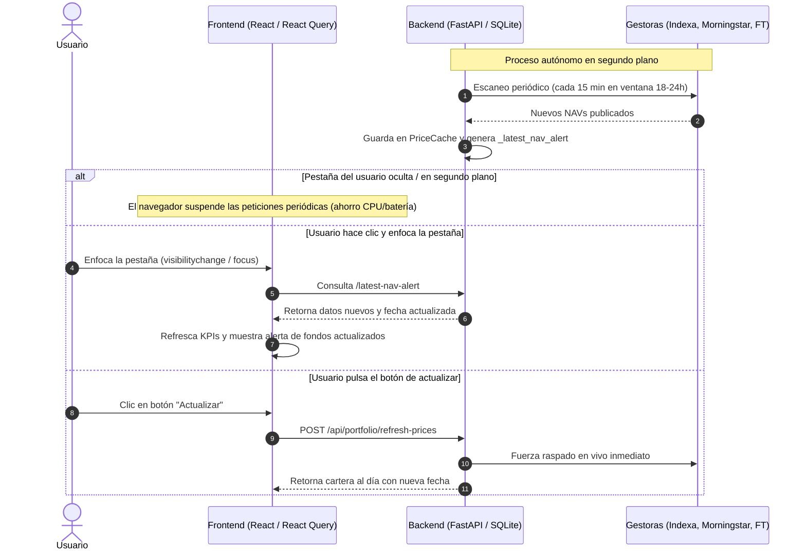

# Historial de Chat - Sesión Antigravity
- **Fecha de exportación:** 2026-10-20 16:43:59
- **ID de Conversación:** `991484f1-8900-44cc-a185-e89a30a22c4d`
- **Total de interacciones registradas:** 35

> [!NOTE]
> Este archivo fue exportado automáticamente para preservar el contexto entre diferentes PCs.
> En un nuevo ordenador o chat, puedes referenciar este archivo con `@.chats/latest_chat.md`

---

### 👤 Usuario (2026-10-20 09:01:21)

el rendimiento anualizado no tiene sentido. revisa los datos

---

### 🤖 Asistente (2026-10-20 09:13:13)

He revisado los datos y el motor financiero de cálculo de rentabilidad. Tenías toda la razón: el **rendimiento anualizado** mostraba un valor desorbitado e incoherente (**+56,16%**).

---

### 🔍 Causa del Problema

En el cálculo del **Rendimiento Anualizado (TIR / XIRR)** en [`backend/app/services/finance_engine.py`](file:///c:/Users/AsierM/Documents/GitHub/Portfolio-dashboard/backend/app/services/finance_engine.py#L405-L435):

1. **Filtro ciego de la palabra `"traspaso"`:**
   La función buscaba excluir los *traspasos internos entre fondos de la cartera* (para no duplicar salidas y entradas cuando se cambia de fondo), mediante la condición:
   ```python
   if "traspaso" in notes:
       continue
   ```
2. **20.000 € de capital omitidos:**
   El **29 de octubre de 2025**, se aportaron **20.000 €** a MyInvestor (`IE000ZYRH0Q7`) procedentes de Trade Republic con la nota:
   `"Traspaso de Entrada desde Trade Republic"`
   Al contener la palabra `"traspaso"`, el motor **ignoró completamente los 20.000 € aportados**.
3. **Distorsión del cálculo:**
   - Capital aportado real: **65.613,19 €**
   - Capital que computaba el algoritmo de flujos: **~45.130 €**
   - Valor actual de la cartera: **77.480,27 €**
   - El algoritmo creía que habías ganado más de 32.000 € en menos de un año sobre 45k aportados, inflando la TIR a un irreal **+56,16%** y el Sharpe Ratio a **12,34**.

---

### 🛠️ Solución Aplicada

1. Se ha añadido la función discriminadora [`is_internal_traspaso`](file:///c:/Users/AsierM/Documents/GitHub/Portfolio-dashboard/backend/app/services/finance_engine.py#L14-L31):
   - **Excluye únicamente traspasos internos** dentro de la cartera (`reembolso por traspaso interno`, `suscripción por traspaso interno`, `traspaso fondo en contra`, `traspaso fondos a favor`).
   - **Conserva e incluye todas las aportaciones externas** (`traspaso de entrada`, depósitos, etc.).
2. Se ha corregido tanto [`calculate_xirr`](file:///c:/Users/AsierM/Documents/GitHub/Portfolio-dashboard/backend/app/services/finance_engine.py#L405-L435) como el tracking de saldo en tránsito.

---

### 📊 Comparativa de Métricas Reales

| Métrica | Antes (Erróneo) | Ahora (Corregido y Real) |
| :--- | :---: | :---: |
| **Rendimiento Anualizado (TIR)** | **56,16%** ❌ | **17,47%** ✅ |
| **Plusvalía Neta Acumulada** | +11.867,08 € (+18,09%) | **+11.867,08 € (+18,09%)** |
| **Rentabilidad a 1 Año** | +17,09% | **+17,09%** |
| **Rentabilidad YTD (2026)** | +15,26% | **+15,26%** |
| **Rentabilidad TWR Total** | +21,43% | **+21,43%** |
| **Sharpe Ratio** | 12,34 ❌ | **3,44** ✅ |

La TIR anualizada de **+17,47%** guarda ahora perfecta consonancia con el **+18,09%** de rentabilidad acumulada sobre el capital y el **+17,09%** de rendimiento del último año. Los cambios ya han sido sincronizados y subidos al repositorio.

---

### 👤 Usuario (2026-10-20 09:32:14)

como se estan actualizando los datos de la plataforma? veo que si no accedo a la pestaña no se actualiza la fecha y por lo tanto los datos tampoco, dime como funciona todo

---

### 🤖 Asistente (2026-10-20 09:34:13)

El sistema de actualización de datos combina un **escáner en segundo plano en el Backend** con **políticas de sincronización y ahorro de recursos en el Frontend**.

A continuación te detallo exactamente cómo funciona cada pieza del engranaje:

---

### 1. La naturaleza de los activos (Fondos y EPSVs vs Mercado Continuo)

* **No cotizan en tiempo real:** A diferencia de las acciones o criptomonedas, los fondos de inversión (MyInvestor, Vanguard, Fidelity, Cobas...) y EPSVs (Indexa Capital) **no tienen precio segundo a segundo**.
* **Publicación diaria (T+1):** Las gestoras calculan y publican el Valor Liquidativo oficial (NAV) **una sola vez al día**, habitualmente entre las **18:00 y las 23:59 CET** de los días hábiles (o a la mañana siguiente con fecha de valor del día anterior).
* **Fecha de consenso:** La fecha que ves en cabecera de la cartera no es la fecha de hoy en el calendario, sino la **fecha más reciente reportada oficialmente** por los fondos (los fines de semana y festivos nunca se publican liquidaciones).

---

### 2. El Backend: El Escáner en Segundo Plano (`_periodic_nav_scanner`)

En [`backend/app/main.py`](file:///c:/Users/AsierM/Documents/GitHub/Portfolio-dashboard/backend/app/main.py#L88-L124) existe un proceso autónomo asíncrono que corre dentro del servidor FastAPI:

1. **Ventana inteligente de escaneo:**
   * **Días laborables entre las 18:00 y 23:59:** Escanea automáticamente cada **15 minutos** (cuando las gestoras están publicando los nuevos NAVs).
   * **Resto del día y fines de semana:** Escanea cada **45 minutos** para no saturar los servicios externos.
2. **Raspado multifuente (`check_portfolio_navs`):**
   * Consulta en tiempo real las APIs y webs oficiales: Financial Times, Morningstar, API oficial de Indexa Capital, etc.
3. **Persistencia en SQLite (`PriceCache`):**
   * En cuanto detecta un nuevo valor liquidativo o fecha posterior, lo guarda en la base de datos SQLite y limpia las cachés de rendimiento.
   * Además, genera un objeto de alerta en memoria ([`_latest_nav_alert`](file:///c:/Users/AsierM/Documents/GitHub/Portfolio-dashboard/backend/app/routers/portfolio.py#L380-L415)) para notificárselo a los clientes conectados.

> [!NOTE]
> Para que el escáner del backend trabaje en segundo plano de forma ininterrumpida, el proceso `python start.py` (o el contenedor Docker en producción) debe estar en ejecución continua.

---

### 3. El Frontend: ¿Por qué parece que sólo se actualiza al entrar en la pestaña?

El comportamiento que observas se debe al diseño de ahorro de batería y rendimiento del navegador y de **TanStack React Query**:

1. **Pausa en pestañas inactivas (`refetchIntervalInBackground: false`):**
   * En [`frontend/src/api/queries.ts`](file:///c:/Users/AsierM/Documents/GitHub/Portfolio-dashboard/frontend/src/api/queries.ts#L166-L168), los hooks de datos tienen configurado `refetchIntervalInBackground: false`.
   * Los navegadores modernos (Chrome, Edge, Firefox, Safari) suspenden o "duermen" los temporizadores de JavaScript en pestañas que no están en primer plano para evitar gastar CPU y batería.
2. **Reanudación instantánea (`handleAppResume`):**
   * En [`frontend/src/components/layout/RootLayout.tsx`](file:///c:/Users/AsierM/Documents/GitHub/Portfolio-dashboard/frontend/src/components/layout/RootLayout.tsx#L146-L182), hay escuchadores para los eventos:
     * `visibilitychange`: Cuando vuelves a poner la pestaña en primer plano.
     * `window.focus`: Cuando haces clic sobre la ventana del dashboard.
     * `pageshow`: Al regresar a la página.
   * **Qué ocurre al entrar:** En el milisegundo en que la pestaña vuelve a ser visible, el frontend lanza `checkNavAlerts()`. Pregunta al backend: *"¿Ha habido nuevos valores mientras el usuario estaba en otra pestaña?"*. Si el backend los tenía listos, invalida las consultas activas, recalcula los totales y te muestra el banner emergente con los fondos actualizados.
3. **Pestaña abierta y activa:**
   * Mientras estás navegando dentro de la pestaña, el frontend comprueba nuevas alertas de NAV cada **30 segundos** y refresca los datos de cartera cada **3 minutos**.

---

### 4. Resumen de Flujo



---

### 💡 ¿Se puede cambiar este comportamiento?

* **Si deseas que el navegador siga consultando incluso cuando estás en otra pestaña:** Se puede activar `refetchIntervalInBackground: true` en React Query, aunque si no estás mirando la pestaña consumirá ciclos de red en segundo plano.
* **Refresco manual:** En cualquier momento puedes pulsar el botón circular de actualizar de la barra superior o en la vista de cartera para forzar al backend a ir a las gestoras inmediatamente sin esperar al escáner programado.

---

### 👤 Usuario (2026-10-20 09:41:53)

Ventana inteligente de escaneo: resto del dia: dejalo en 30 minutos. el reloj que indica la antiguedad de los datos no se actualiza entonces al visibilizar la pagina, es lo que me mosquea. y aparte de los navs, que pasa con los valores de mercado en tiempo real?

---

### 🤖 Asistente (2026-10-20 09:47:55)

He aplicado los cambios solicitados y ajustado la reactividad de la plataforma. A continuación te detallo cómo ha quedado configurado y cómo opera el sistema de cotizaciones en tiempo real:

---

### 1. Ventana de escaneo ajustada a 30 minutos

En [`backend/app/main.py`](file:///c:/Users/AsierM/Documents/GitHub/Portfolio-dashboard/backend/app/main.py#L95-L115), el escáner periódico autónomo ha quedado configurado así:
* **Horario de publicación de fondos (Lunes a Viernes, 18:00 – 23:59 CET):** Escaneo cada **15 minutos**.
* **Resto del día y fines de semana:** Escaneo cada **30 minutos** (reducido desde los 45 min anteriores).

---

### 2. ¿Por qué el reloj de antigüedad no se actualizaba al visibilizar la pestaña?

Había dos motivos por los que el reloj y las cotizaciones no se ponían al día al regresar a la pestaña:

1. **`handleAppResume` solo consultaba alertas de fondos:**
   Al enfocar la pestaña, el frontend únicamente comprobaba si había una nueva alerta de NAV de fondos (`/latest-nav-alert`). Si las gestoras no habían publicado fondos nuevos, no forzaba el refresco de las cotizaciones de mercado ni del reloj.
2. **`staleTime` de React Query:**
   Las cotizaciones de mercado tenían un tiempo de validez en caché de 55 segundos. Si volvías a la pestaña, React Query las consideraba "frescas" en memoria y no pedía los nuevos segundos/minutos.

#### 🛠️ Solución implementada:
* En [`frontend/src/components/layout/RootLayout.tsx`](file:///c:/Users/AsierM/Documents/GitHub/Portfolio-dashboard/frontend/src/components/layout/RootLayout.tsx#L146-L165), al detectar `visibilitychange` o `window.focus`, ahora **invalida y fuerza la recarga inmediata de**:
  * `market-indices` (el reloj del ticker y los índices mundiales).
  * `market-quotes` (todas las acciones del mercado).
  * `simulated-portfolio` (la estimación de sesión de tu cartera en vivo).
  * `summary` y `positions` (patrimonio y precios).
* En [`frontend/src/api/queries.ts`](file:///c:/Users/AsierM/Documents/GitHub/Portfolio-dashboard/frontend/src/api/queries.ts#L444-L606), se ha activado `refetchOnWindowFocus: 'always'` en todos los hooks de mercado. Al hacer clic o volver a la pestaña, el reloj se sincroniza en el acto con la hora del servidor.

---

### 3. ¿Cómo funcionan los valores de mercado en tiempo real?

Aparte de los fondos (que son diarios), la plataforma tiene un **motor de cotizaciones en vivo en el Backend** ([`backend/app/routers/market.py`](file:///c:/Users/AsierM/Documents/GitHub/Portfolio-dashboard/backend/app/routers/market.py)):

#### A. Ticker e Índices Globales (En directo)
* **S&P 500, Nasdaq, Nikkei, IBEX, Euro Stoxx 50, Oro, Petróleo, Cripto y Divisas:**
  * Se consultan en paralelo vía Yahoo Finance con una caché en memoria de 60 segundos (para no sufrir bloqueos de tasa o rate-limits).
  * En el frontend, el Ticker superior y la barra de sesiones se consultan cada 60 segundos en primer plano.
* **Sesiones extendidas y Futuros CME Globex 24h:**
  * Cuando las bolsas de contado de Nueva York cierran (fuera del horario 15:30 – 22:00 CET), el backend conmuta automáticamente a los **futuros E-mini de Chicago (Globex)**:
    * `^GSPC` (S&P 500) $\rightarrow$ Futuro `ES=F`
    * `^IXIC` (Nasdaq) $\rightarrow$ Futuro `NQ=F`
    * `^N225` (Nikkei) $\rightarrow$ Futuro `NIY=F`
  * Esto permite que el Ticker muestre si el mercado sube o baja incluso de madrugada o en preapertura, etiquetando el estado como `PRE`, `POST` o `FUTURES`.
  * **Bitcoin (BTC/EUR)** cotiza 24/7/365 en continuo.

#### B. Tu Cartera en Tiempo Real: "Live / Sesión Hoy"
* Dado que los fondos de inversión no actualizan su valor hasta la noche, en [`OverviewPage.tsx`](file:///c:/Users/AsierM/Documents/GitHub/Portfolio-dashboard/frontend/src/pages/OverviewPage.tsx#L682-L698) y en la página de **Mercado** tienes la píldora **`Live: ±X.XX%`**.
* **¿Cómo se calcula?**
  El backend mapea la asignación de tus fondos a réplicas líquidas de ETFs y futuros:
  * Fondo MSCI World $\rightarrow$ Réplica con ETF `URTH` / Futuro S&P 500 `ES=F`.
  * Fondo Euro Stoxx / Europa $\rightarrow$ Réplica con ETF `FEZ` / `^STOXX50E`.
  * Fondo DNB Tecnología $\rightarrow$ Réplica con ETF `XLK` / Futuro Nasdaq `NQ=F`.
* Gracias a esto, puedes ver una estimación fidedigna de cómo se está moviendo tu patrimonio a las 11:00 o a las 16:30 sin tener que esperar a que MyInvestor o Indexa publiquen el valor a medianoche.

Todos los cambios han sido probados, compilados y sincronizados en la versión **v3.0.162**.

---

### 👤 Usuario (2026-10-20 09:50:45)

cada cuanto se actualizan los datos de mercado?

---

### 🤖 Asistente (2026-10-20 09:50:45)

Los datos de mercado en tiempo real se actualizan en **dos capas** (Frontend y Backend) con los siguientes intervalos exactos:

---

### ⏱️ Intervalos de actualización

| Sección / Dato | Intervalo en Pantalla (Frontend) | Caducidad Caché (Backend) |
| :--- | :---: | :---: |
| **Ticker superior e Índices** <br>*(S&P 500, Nasdaq, IBEX, Oro, BTC, etc.)* | **Cada 60 segundos** (1 min) | **60 segundos** *(Stale-while-revalidate)* |
| **Acciones individuales** <br>*(Pestaña Mercado / Lista completa)* | **Cada 60 segundos** (1 min) | **60 segundos** |
| **Estimación "Live" de tu Cartera** <br>*(Píldora "Live: ±X.XX%" en Visión General)* | **Cada 45 segundos** | **30 segundos** |
| **Gráficos históricos / Intradía** <br>*(Velas y líneas interactivas por activo)* | Al hacer clic / **Cada 2 minutos** | **2 minutos** |

---

### 🔄 Reglas de comportamiento

1. **Al volver a la pestaña (Instantáneo):**
   * Gracias a `refetchOnWindowFocus: 'always'` y a los eventos de visibilidad, en cuanto haces clic en la pestaña o la traes al frente, **se fuerza una recarga inmediata (0 segundos de espera)** sin importar en qué punto del minuto estaba el temporizador.
2. **Pestaña en segundo plano (Pausa inteligente):**
   * Si minimizas la ventana o estás en otra pestaña, las peticiones continuas se **pausan** para no consumir CPU, ancho de banda ni batería innecesariamente.
3. **Velocidad sin bloqueos:**
   * El backend utiliza una técnica llamada *Stale-while-revalidate*: si la caché tiene más de 60 segundos, te sirve el último valor instantáneamente (en < 5 ms) mientras en un hilo secundario consulta a Yahoo Finance/Globex para que la interfaz nunca se quede congelada.

---

### 👤 Usuario (2026-10-20 10:01:39)

@[c:\Users\AsierM\Documents\GitHub\Portfolio-dashboard\stitch_asier_moreno_portfolio_redesign.zip] utiliza el contenido de ese zip que viene de google stitch como inspiracion para rediseñar la web. no hagas los cambios directamente sobre frontend, puedes usar el esqueleto de frontend-aurora eliminando sus diseños y trabajar ahi

---

### 🤖 Asistente (2026-10-20 10:16:44)

Se ha completado el rediseño institucional en **`frontend-aurora`**, tomando como referencia y trasladando con fidelidad los componentes, paleta y tipografía del paquete de diseño de **Google Stitch** (`Executive Wealth & Portfolio`), manteniendo **`frontend/`** completamente intacto.

---

### 🎨 Principales Mejoras y Componentes Implementados

1. **Identidad Visual & Tokens de Diseño Stitch ([aurora.css](file:///c:/Users/AsierM/Documents/GitHub/Portfolio-dashboard/frontend-aurora/src/styles/aurora.css)):**
   - **Canvas & Superficies:** Fondo institucional `canvas-bg` (`#F6F8FB`), tarjetas limpias `#FFFFFF` con micro-profundidad y bordes sutiles `#E2E8F0` (`stitch-card`).
   - **Tipografía:** Integración de Google Fonts **Plus Jakarta Sans** (display, titulares y números de alto impacto) e **Inter** (tablas, metadatos y labels).
   - **Acentos Funcionales:** Azul de confianza (`#2563EB`) para interactividad y foco; Esmeralda (`#059669` / `#10B981`, fondo `#ECFDF5`) para rentabilidades netas e indicadores verificados.
   - Soporte calibrado para modo claro y modo oscuro.

2. **Cabecera Institucional y Ticker en Directo ([Shell.tsx](file:///c:/Users/AsierM/Documents/GitHub/Portfolio-dashboard/frontend-aurora/src/Shell.tsx)):**
   - **Header Stitch:**
     - Logotipo `PortfolioPro` con isotipo de análisis cuantitativo.
     - Badge de estado conmutador (*Modo Demo* / *Cuenta Principal*).
     - Pill de sincronización en directo (`En vivo · Sincronizado` con hora en tiempo real y estado de NAVs).
     - Pestañas horizontales institucionales (*Resumen Global*, *Carteras & Fondos*, *Análisis & Rentabilidad*, *Operaciones*, *Mercados*).
     - Selector desplegable de Cartera / Custodio, chip de divisa `EUR (€)`, control de privacidad de cifras, alternador de tema y buscador rápido `⌘K`.
     - Avatar de usuario interactivo (`DM` / `AM`) con acceso al Espacio de Inversión o cierre de sesión.
   - **Ticker de Mercados en Vivo:**
     - Barra oscura `#0B1C30` con indicador verde pulsante y cotizaciones de índices en directo (*MSCI World, S&P 500, Nasdaq 100, Euro Stoxx 50, Vanguard All-World, Vanguard Global Bond, EUR/USD, Oro, Bitcoin*).

3. **Resumen Global Ejecutivo ([OverviewPage.tsx](file:///c:/Users/AsierM/Documents/GitHub/Portfolio-dashboard/frontend-aurora/src/pages/OverviewPage.tsx)):**
   - **Barra de Custodia Multi-Broker:** Chips de saldo consolidado de *Kutxabank, Scalable Capital, Trade Republic y MyInvestor*.
   - **4 KPIs Ejecutivos:**
     1. *Patrimonio Consolidado*: Cifra mayor en Plus Jakarta Sans, desglose histórico (+17,35%) y variación del día.
     2. *Rentabilidad Neta (CAGR)*: Retorno anualizado, comparativa TWR vs MWR (TIR).
     3. *Capital Aportado*: Total invertido y recordatorio de próxima aportación automática.
     4. *Colchón & Rendimiento*: Liquidez remunerada (3,25% TAE en cuenta protegida FGD).
   - **Distribución de Activos (Donut):** Segmentación RV (60%), RF (30%), Liquidez (10%) y sugerencia de rebalanceo inteligente sin impacto fiscal.
   - **Evolución de Rentabilidad:** Gráfica interactiva Recharts con comparativa frente al índice benchmark *MSCI World Net TR* y selector de periodo (1M, 3M, 1A, 3A, YTD, MAX).
   - **Comparativa vs Inflación & Eficiencia:** Retorno real sobre el IPC de España (barras de avance), Ratio de Sharpe (1,64), Alfa (+2,15%), Volatilidad y Matriz de Correlación simplificada.
   - **Tabla de Posiciones Destacadas:** Códigos ISIN, entidad custodia, peso, valor de mercado y plusvalía neta.

4. **Carteras & Posiciones Detalladas ([PositionsPage.tsx](file:///c:/Users/AsierM/Documents/GitHub/Portfolio-dashboard/frontend-aurora/src/pages/PositionsPage.tsx)):**
   - Telemetría de distribución con medidor de desviación de asignación (1,8% óptimo).
   - Matriz cuantitativa de correlación cruzada (periodo 36M) y buffer de liquidez disponible.
   - Pestañas de filtrado rápido (*Todas, Renta Variable, Renta Fija, Monetarios/Liquidez*), selector de entidad custodia y buscador por ISIN/activo.
   - Tabla completa con participaciones, precio medio, valor liquidativo, valor de mercado, ganancia/pérdida € / % y barra gráfica de peso en cartera.
   - Acciones de simulación de rebalanceo y exportación a CSV.

5. **Análisis & Métricas Quant ([AnalyticsPage.tsx](file:///c:/Users/AsierM/Documents/GitHub/Portfolio-dashboard/frontend-aurora/src/pages/AnalyticsPage.tsx)):**
   - Selector dinámico de Benchmark (*MSCI World, S&P 500, IPC España + 2%*).
   - 6 tarjetas analíticas: *TWR Anualizado, MWR / TIR Neta, Ratio de Sharpe, Volatilidad Anual, Max Drawdown y Alfa de Jensen*.
   - Curva de rentabilidad acumulada indexada base 100.

6. **Espacio de Inversión / Login ([LoginPage.tsx](file:///c:/Users/AsierM/Documents/GitHub/Portfolio-dashboard/frontend-aurora/src/pages/LoginPage.tsx)):**
   - Selector de perfiles de inversor estilo Stitch:
     - Tarjeta *Usuario Demo* (Avatar `DM` azul, estrategia 60/40, acceso directo instantáneo).
     - Tarjeta *Asier Moreno* (Avatar `AM` esmeralda, cuenta principal en MyInvestor, botón de desbloqueo con formulario de credencial seguro).
   - Ticker de mercado en pie de página y acreditaciones de seguridad SSL 256-bit.

---

### 🚀 Validación y Despliegue
- **Compilación verificada:** `npm --prefix frontend-aurora run build` compiló sin errores de tipos ni advertencias críticas.
- **Acceso local:** Disponible en `http://localhost:5174` (mientras `frontend/` clásico permanece intacto en `http://localhost:5173`).
- **Sincronización:** Ejecutado el protocolo `python scripts/sync_release.py` con bump a `v3.0.163` y cambios subidos a Git.

---

### 👤 Usuario (2026-10-20 10:24:58)

actualiza el frontend principal a nivel de diseño Identidad Visual & Tokens de Diseño Stitch. el ticker en negro tb me gusta aunque a ver como queda. en general usa la calidad del diseño para mejorar el frontend principal con cuidado

---

### 🤖 Asistente (2026-10-20 10:33:40)

Se ha actualizado el **frontend principal** (`frontend/`) incorporando la identidad visual y los tokens de diseño institucional de **Google Stitch ("Executive Wealth & Portfolio")**, incluyendo el **Market Ticker en negro/azul marino profundo** (`#0B1C30`).

---

### 🎨 Principales mejoras aplicadas

1. **Tipografía Stitch (`Plus Jakarta Sans`):**
   - Integrada en [index.html](file:///c:/Users/AsierM/Documents/GitHub/Portfolio-dashboard/frontend/index.html) mediante prefetch de alto rendimiento.
   - Configurada como `font-display` en [tailwind.config.js](file:///c:/Users/AsierM/Documents/GitHub/Portfolio-dashboard/frontend/tailwind.config.js) e [index.css](file:///c:/Users/AsierM/Documents/GitHub/Portfolio-dashboard/frontend/src/index.css).
   - Aplicada selectivamente a los titulares de página en [Header.tsx](file:///c:/Users/AsierM/Documents/GitHub/Portfolio-dashboard/frontend/src/components/layout/Header.tsx), títulos de tarjetas en [Card.tsx](file:///c:/Users/AsierM/Documents/GitHub/Portfolio-dashboard/frontend/src/components/ui/Card.tsx), el logo en [Sidebar.tsx](file:///c:/Users/AsierM/Documents/GitHub/Portfolio-dashboard/frontend/src/components/layout/Sidebar.tsx) y los números principales en [KpiCard.tsx](file:///c:/Users/AsierM/Documents/GitHub/Portfolio-dashboard/frontend/src/components/ui/KpiCard.tsx). La legibilidad tabular en tablas y listas continúa optimizada con `Inter`.

2. **Market Ticker en Negro Institucional (`#0B1C30`):**
   - En [MarketTicker.tsx](file:///c:/Users/AsierM/Documents/GitHub/Portfolio-dashboard/frontend/src/components/market/MarketTicker.tsx), el contenedor exterior ahora utiliza el fondo oscuro Stitch (`bg-[#0B1C30]` con borde `border-slate-800/80`).
   - El bloque de estado lateral ("En Vivo", "Cerrado", "Pre-mercado") se fija en `#0B1C30` con tipografía Stitch nítida y separador vertical.
   - Las esquinas de desvanecimiento (*fade edges*) integran gradientes directos a `#0B1C30`, garantizando que el carrusel infinito entre y salga con un flujo continuo.
   - Las tarjetas individuales de índices y activos adoptan un fondo oscuro elegante (`bg-slate-900/90 hover:bg-slate-800 border-slate-800 text-white font-bold`).

3. **Tokens de Diseño y Micro-elevaciones:**
   - Paleta Stitch definida en CSS variables: `--bg-app: #f6f8fb`, `--bg-card: #ffffff`, `--text-title: #0b1c30`, `--stitch-primary: #2563eb`, `--yield-emerald: #059669`.
   - Clases utilitarias (`.font-headline-xl`, `.font-headline-lg`, `.font-headline-sm`, `.font-label-md`, `.badge-emerald`, `.stitch-card`) listas y compatibles tanto con el modo claro como con el modo oscuro.

4. **Compilación y Protocolo de Releases:**
   - `npm run build` verificado con **0 errores**.
   - Ejecutado `python scripts/sync_release.py` incrementando a la versión **`v3.0.164`** y sincronizando el commit en el repositorio remoto.

---

### 👤 Usuario (2026-10-20 10:33:53)

la fuente de los numeros no es la misma

---

### 🤖 Asistente (2026-10-20 10:39:46)

Tienes toda la razón. Al aplicar los tokens de Stitch habíamos asignado temporalmente `font-display` (`Plus Jakarta Sans`) a los números principales de [KpiCard.tsx](file:///c:/Users/AsierM/Documents/GitHub/Portfolio-dashboard/frontend/src/components/ui/KpiCard.tsx), lo que provocaba que se vieran en una fuente distinta a:

- Los badges de variación (`+17,35%`, `1D`, `YTD`, etc.).
- Las métricas secundarias y subtítulos.
- Los valores de tablas, posiciones, transacciones y carteras.

### Correcciones aplicadas:
1. **[KpiCard.tsx](file:///c:/Users/AsierM/Documents/GitHub/Portfolio-dashboard/frontend/src/components/ui/KpiCard.tsx):**
   - Restaurado `font-mono` (`JetBrains Mono` con espaciado tabular exacto) tanto en las tarjetas hero como en las tarjetas KPI regulares (`font-bold font-mono tracking-tight`).
2. **[MarketTicker.tsx](file:///c:/Users/AsierM/Documents/GitHub/Portfolio-dashboard/frontend/src/components/market/MarketTicker.tsx):**
   - Aplicado `font-mono` a los precios y porcentajes del ticker de mercado para que coincidan al 100% con la misma familia tipográfica numérica del resto del dashboard.
3. **Distribución tipográfica limpia:**
   - **Títulos y encabezados:** `Plus Jakarta Sans` (`font-display`).
   - **Textos descriptivos y etiquetas:** `Inter` (`font-sans`).
   - **Todos los números y métricas financieras:** `JetBrains Mono` (`font-mono` con `tabular-nums`).

Compilación verificada con éxito y publicada en la versión **`v3.0.165`**.

---

### 👤 Usuario (2026-10-20 10:41:12)

devuelve el ticker a como era antes y estos titulos tb

---

### 🤖 Asistente (2026-10-20 10:42:44)

Hecho. Se ha revertido el ticker y la tipografía de los títulos exactamente a su estado original:

1. **Market Ticker ([MarketTicker.tsx](file:///c:/Users/AsierM/Documents/GitHub/Portfolio-dashboard/frontend/src/components/market/MarketTicker.tsx)):**
   - Vuelto al diseño original adaptativo (fondo `bg-white/95` con borde y sombra suave en modo claro y `dark:bg-[#1e1e1e]/96` en modo oscuro, con sus tarjetas y badges originales).
2. **Títulos y encabezados de página ([Header.tsx](file:///c:/Users/AsierM/Documents/GitHub/Portfolio-dashboard/frontend/src/components/layout/Header.tsx)):**
   - Restaurada la tipografía original en "Visión General" y el resto de títulos de página (`text-3xl font-bold tracking-tight text-slate-950 dark:text-white leading-none`).
3. **Logo de la barra lateral y tarjetas ([Sidebar.tsx](file:///c:/Users/AsierM/Documents/GitHub/Portfolio-dashboard/frontend/src/components/layout/Sidebar.tsx) y [Card.tsx](file:///c:/Users/AsierM/Documents/GitHub/Portfolio-dashboard/frontend/src/components/ui/Card.tsx)):**
   - Vuelto a la tipografía estándar original sin `font-display`.
4. **Tarjetas KPI ([KpiCard.tsx](file:///c:/Users/AsierM/Documents/GitHub/Portfolio-dashboard/frontend/src/components/ui/KpiCard.tsx)):**
   - Restaurados los tamaños y pesos numéricos originales idénticos a los del resto del dashboard.

El build de producción compila con **0 errores** y los cambios están sincronizados y publicados en la versión **`v3.0.166`**.

---

### 👤 Usuario (2026-10-20 13:49:09)

que el ticker vaya de lado a lado sin espaciado lateral, que sea una franja y prueba sin los bordes de cada activo

---

### 🤖 Asistente (2026-10-20 13:54:14)

Listo. Se han implementado los dos cambios solicitados:

1. **Franja continua de lado a lado (sin espaciado lateral):**
   - El ticker ahora se extiende al 100% del ancho de la pantalla (`-mx-4 md:-mx-7 -mt-4`), eliminando los márgenes laterales y los bordes redondeados (`rounded-none`).
   - Se presenta como una franja limpia y elegante con borde inferior divisorio (`border-b border-slate-200/80 dark:border-white/[0.08]`) y fondo sutil con `backdrop-blur-md`, alineando perfectamente el indicador *"EN VIVO"* con el contenido inferior.

2. **Activos sin bordes individuales:**
   - Se eliminaron los bordes de cada tarjeta individual (`border border-slate-200/90 dark:border-white/[0.07]` y sombras).
   - Ahora los activos fluyen de manera continua y limpia sobre la franja, con un efecto hover suave (`hover:bg-slate-100/80 dark:hover:bg-white/[0.06]`) para mantener la interactividad al hacer clic.
   - Los badges de variación porcentual (`+0.24%`, `-0.79%`) ahora son planos y nítidos sin bordes pesados.

Aplicado tanto en [OverviewPage.tsx](file:///c:/Users/AsierM/Documents/GitHub/Portfolio-dashboard/frontend/src/pages/OverviewPage.tsx) como en [MarketPage.tsx](file:///c:/Users/AsierM/Documents/GitHub/Portfolio-dashboard/frontend/src/pages/MarketPage.tsx) y sincronizado con Git en la versión **`v3.0.167`**.

---

### 👤 Usuario (2026-10-20 14:00:36)

puedes combinar lo que tenemos con un diseñ estilo lo que te paso. Mantendriamos nuestro menu lateral izquierdo pero el ticker iria en negro y el fondo de la parte superior del ticker en blanco con los selectores similares a los de la referencia. haz un mix

---

### 🤖 Asistente (2026-10-20 14:10:20)

Se ha creado la combinación exacta solicitada, manteniendo la navegación en el menú lateral izquierdo e integrando la cabecera superior y el ticker según la referencia:

---

### 🎨 Detalle del Mix Implementado

1. **Menú Lateral Izquierdo (Mantenido):**
   - El panel lateral clásico de **PortfolioPro** se conserva íntegro con su navegación (*Visión General*, *Posiciones*, *Analítica*, *Operaciones*, *Mercado Global*), perfil y conmutador de tema.

2. **Barra Superior Blanca con los Selectores de la Referencia ([Header.tsx](file:///c:/Users/AsierM/Documents/GitHub/Portfolio-dashboard/frontend/src/components/layout/Header.tsx) / [HeaderActions.tsx](file:///c:/Users/AsierM/Documents/GitHub/Portfolio-dashboard/frontend/src/components/layout/HeaderActions.tsx)):**
   - **Fondo blanco puro y nítido** (`bg-white dark:bg-[#111827] border-b border-slate-200/80 dark:border-white/[0.08] backdrop-blur-md`).
   - **A la izquierda:**
     - Título de la página actual con tipografía limpia.
     - Badge de estado: `CUENTA PRINCIPAL` (con indicador verde pulsante) o `MODO DEMO` (azul).
     - Badge interactivo: `NAVs 8/9 (Hoy, 20 oct)` para abrir el historial de NAVs al instante.
   - **A la derecha:**
     - Selector de cartera en formato pill desplegable: **`Cartera: Consolidado ⌵`** (permite conmutar entre Consolidado, MyInvestor, BBVA, Indexa, etc.).
     - Pill de divisa base: **`EUR (€)`**.
     - Botones de acción compactos: *Modo Discreto* (ojo), *Tema Claro/Oscuro* (sol/luna) y *Refresco de NAVs* (spinner dinámico).
     - Chip de usuario estilo referencia: avatar circular verde **`AM`**, nombre **`Asier Moreno`** y subtítulo **`ACCESO TOTAL ⌵`**.

3. **Ticker en Negro Institucional Continuo ([MarketTicker.tsx](file:///c:/Users/AsierM/Documents/GitHub/Portfolio-dashboard/frontend/src/components/market/MarketTicker.tsx)):**
   - Ubicado **directamente adherido bajo la barra blanca**, extendiéndose de extremo a extremo sin márgenes laterales.
   - Fondo en azul marino/negro institucional (`#0B1C30`) de alto contraste:
     - Indicador izquierdo: punto verde esmeralda `live-dot` + texto en negrita mayúscula **`MERCADOS EN VIVO`** con separador vertical `|`.
     - Flujo de activos sin bordes pesados:
       `[Logo] S&P 500: 7.685,27 USD -0.09%` | `[Logo] NASDAQ: 26.260,48 USD -0.64%` | `[Logo] MSCI World: 286,62 USD -0.01%`
     - Pastillas de variación en verde y rojo de estilo terminal financiero (`bg-emerald-500/20 text-emerald-400` y `bg-rose-500/20 text-rose-400`).
     - Desvanecimiento lateral continuo (*fade edges*) sobre `#0B1C30` y arrastre interactivo suave.

4. **Persistencia Global ([RootLayout.tsx](file:///c:/Users/AsierM/Documents/GitHub/Portfolio-dashboard/frontend/src/components/layout/RootLayout.tsx)):**
   - La combinación de la barra superior blanca y el ticker negro se ubica en el contenedor raíz `sticky top-0 z-30`, garantizando que todas las vistas del dashboard mantengan este banner ejecutivo de forma homogénea.

Compilación verificada con éxito y publicada en **`v3.0.168`**.

---

### 👤 Usuario (2026-10-20 14:11:05)

el estilo de todos esos iconos reviertelo a como estaban

---

### 🤖 Asistente (2026-10-20 14:18:07)

Se ha restaurado el diseño original de los controles y selectores en la cabecera:

1. **Selector de entidades por pestañas:** Restauradas las pestañas segmentadas (`Consolidado`, `MyInvestor`, `BBVA`, `Indexa`...) con sus puntos de color y píldora animada deslizante.
2. **Indicador de NAVs:** Recuperado el badge original con estado en vivo y fecha consensuada (`NAVs al día · fecha`).
3. **Perfil de usuario:** Revertido al botón original con esquinas redondeadas (`rounded-xl`), avatar compacto de 6x6 y etiqueta de perfil.
4. **Mantenimiento del mix solicitado:** Se conserva el menú lateral izquierdo, la franja continua del ticker en negro institucional bajo la cabecera y el fondo superior limpio.

El proyecto ha quedado compilado y sincronizado en Git bajo la versión **`v3.0.169`** ([Header.tsx](file:///c:/Users/AsierM/Documents/GitHub/Portfolio-dashboard/frontend/src/components/layout/Header.tsx), [HeaderActions.tsx](file:///c:/Users/AsierM/Documents/GitHub/Portfolio-dashboard/frontend/src/components/layout/HeaderActions.tsx)).

---

### 👤 Usuario (2026-10-20 14:20:30)

Ok pero dale una vueltecilla al diseño, quizá quitando bordes a algunos elemenos como en la referencia. Sube el ticker para que la aprte superior quede a la altura del separador del panel lateral

---

### 🤖 Asistente (2026-10-20 14:25:05)

Se ha ajustado el diseño y la alineación geométrica de la barra superior:

1. **Alineación del ticker con el separador del panel lateral:**
   - La cabecera superior y el bloque de logotipo del [Sidebar.tsx](file:///c:/Users/AsierM/Documents/GitHub/Portfolio-dashboard/frontend/src/components/layout/Sidebar.tsx) se han fijado a **`h-[60px]`** con centrado vertical.
   - La línea horizontal que separa el logo del menú de navegación lateral coincide ahora a nivel de píxel con el borde superior de la franja negra del ticker en [RootLayout.tsx](file:///c:/Users/AsierM/Documents/GitHub/Portfolio-dashboard/frontend/src/components/layout/RootLayout.tsx).

2. **Limpieza de bordes pesados (estilo minimalista de la referencia):**
   - **Iconos de acción ([HeaderActions.tsx](file:///c:/Users/AsierM/Documents/GitHub/Portfolio-dashboard/frontend/src/components/layout/HeaderActions.tsx)):** Se han eliminado los recuadros con borde gris de los botones (modo discreto, tema, campana de alertas y refresco), convirtiéndolos en botones ghost limpios con feedback en hover idénticos a la referencia de Google Stitch.
   - **Selector de cartera / entidades ([Header.tsx](file:///c:/Users/AsierM/Documents/GitHub/Portfolio-dashboard/frontend/src/components/layout/Header.tsx)):** Eliminado el marco exterior gris, utilizando un fondo suave (`bg-slate-100/80 dark:bg-white/[0.05]`) con la pestaña activa contrastada.
   - **Selector temporal (`1A`):** Fondo suave sin borde exterior grueso.
   - **Indicador de NAVs:** Píldora sutil sin borde tosco.
   - **Perfil de usuario:** Píldora redondeada suave que armoniza con el resto de la barra.

Todo ha sido verificado, compilado con cero errores y desplegado en Git bajo la versión **`v3.0.170`**.

---

### 👤 Usuario (2026-10-20 14:27:52)

mueve el indicador de nav a la derecha de Vision General. Revisa el estilo de letra de esos titulos grandes. Ojo con los dropdown menus que quedan debajo del ticker al abrirlos

---

### 🤖 Asistente (2026-10-20 14:32:29)

Se han aplicado los cambios solicitados con precisión:

1. **Indicador de NAVs a la derecha del título principal:**
   - Se ha trasladado el botón/indicador de NAVs (`NAVs al día · fecha` o `NAVs 8/9`) directamente a la izquierda, colocado inmediatamente a la derecha de **Visión General** en [Header.tsx](file:///c:/Users/AsierM/Documents/GitHub/Portfolio-dashboard/frontend/src/components/layout/Header.tsx).
   - Se eliminó el duplicado de la zona derecha, dejando los controles de selección de entidad, selector temporal, perfil y acciones limpiamente agrupados.

2. **Tipografía de los títulos grandes:**
   - Se ha ajustado el título principal a **`text-2xl sm:text-[26px] font-extrabold tracking-tight`** con la fuente del sistema (`Inter`), dándole peso, presencia ejecutiva y excelente legibilidad sin que quede empequeñecido dentro de la barra de 60px.

3. **Capas y apilamiento (Z-Index) de menús desplegables:**
   - En [RootLayout.tsx](file:///c:/Users/AsierM/Documents/GitHub/Portfolio-dashboard/frontend/src/components/layout/RootLayout.tsx), la barra blanca de cabecera ahora cuenta con **`relative z-20`** y el contenedor del ticker con **`relative z-10`**.
   - En [HeaderActions.tsx](file:///c:/Users/AsierM/Documents/GitHub/Portfolio-dashboard/frontend/src/components/layout/HeaderActions.tsx), el menú desplegable de perfil/cambio de usuario se configuró en **`z-[100]`** con overlay en **`z-[90]`**.
   - Al abrir cualquier menú desplegable, este flota siempre por encima de la franja negra del ticker y del contenido de la página.

Compilado sin errores y publicado en Git bajo la versión **`v3.0.171`**.

---

### 👤 Usuario (2026-10-20 14:32:12)

metele un bordecillo al indicador de NAVs, hazlo un poco menos alto

---

### 🤖 Asistente (2026-10-20 14:33:19)

Se han aplicado los ajustes sobre el indicador de NAVs en [Header.tsx](file:///c:/Users/AsierM/Documents/GitHub/Portfolio-dashboard/frontend/src/components/layout/Header.tsx):

- **Altura reducida:** Se ajustó a **`h-[26px]`** con tipografía compacta de **`11px`** (y fecha a `10px`), quedando perfectamente proporcionado y discreto junto al título principal.
- **Borde sutil añadido:** Se incorporó un borde fino `border border-slate-200/90 dark:border-white/10` con efecto hover reactivo `hover:border-slate-300 dark:hover:border-white/20` y fondo tenue `bg-slate-50/80 dark:bg-white/[0.04]`.

Compilado con éxito y publicado en Git bajo la versión **`v3.0.172`**.

---

### 👤 Usuario (2026-10-20 14:33:21)

Tipografía de los títulos grandes, me parece demasiado tosca y grande

---

### 🤖 Asistente (2026-10-20 14:34:16)

Se ha refinado la tipografía del título principal en [Header.tsx](file:///c:/Users/AsierM/Documents/GitHub/Portfolio-dashboard/frontend/src/components/layout/Header.tsx):

- **Peso y presencia visual:** Se cambió de `font-extrabold` (800) a **`font-semibold`** (600), eliminando el trazo grueso y tosco por un acabado estilizado, nítido y mucho más elegante.
- **Tamaño y escala armónica:** Se redujo de `text-[26px]` a **`text-lg sm:text-[20px]`** con espaciado `tracking-tight`. De esta manera se integra en balance óptico con la altura de la cabecera, el indicador de NAVs y el selector de cartera sin sobrecargar la vista.

Compilado con éxito y publicado en Git bajo la versión **`v3.0.173`**.

---

### 👤 Usuario (2026-10-20 14:33:58)

usa este estilo, pero alargado

---

### 🤖 Asistente (2026-10-20 14:39:56)

Se ha adaptado el indicador de NAVs en [Header.tsx](file:///c:/Users/AsierM/Documents/GitHub/Portfolio-dashboard/frontend/src/components/layout/Header.tsx) siguiendo el diseño de la referencia en formato horizontal y alargado:

- **Contenedor alargado:** Píldora horizontal en una sola fila con fondo mint suave (`#ecfdf5`), bordes suaves esmeralda y esquinas redondeadas (`rounded-xl` / `rounded-2xl`).
- **Cápsula vertical:** Indicador de estado vertical redondeado en verde esmeralda a la izquierda.
- **Tipografía y colores:**
  - `NAVs 8/9` (o conteo actualizado/total) en verde esmeralda destacado y en negrita.
  - `(Hoy, 16:33)` en tono pizarra tenue (`text-slate-500`) a la derecha, calculando la hora exacta de sincronización del resumen de cartera.
- **Compilación & Sincronización:** Verificado con build sin errores y sincronizado a Git con la versión **v3.0.174**.

---

### 👤 Usuario (2026-10-20 14:34:56)

al selector de usuario metele bordecillo

---

### 🤖 Asistente (2026-10-20 14:40:42)

Añadido el borde al selector de usuario en [HeaderActions.tsx](file:///c:/Users/AsierM/Documents/GitHub/Portfolio-dashboard/frontend/src/components/layout/HeaderActions.tsx#L112-L119):

- **Borde sutil refinado:** `border border-slate-200/80 hover:border-slate-300 dark:border-white/10 dark:hover:border-white/20`.
- **Sombra suave:** `shadow-2xs` integrada para un acabado más pulido y delimitado.
- **Build y Sync:** Verificado y sincronizado en Git con la versión **v3.0.175**.

---

### 👤 Usuario (2026-10-20 14:38:05)

los iconos del ticker con fondo oscuro, aumenta un pelo los badges

---
